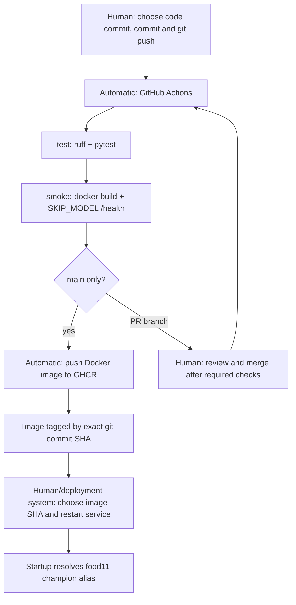
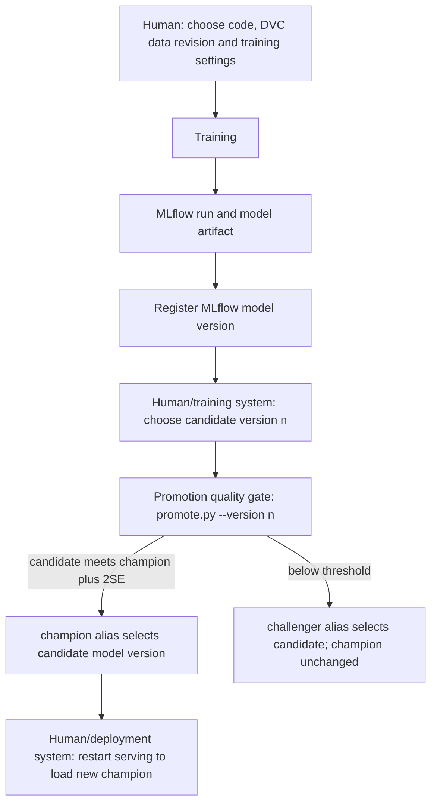

# Lab 5 — CI/CD with GitHub Actions

Implemented and checked locally on 2026-11-14. No commits, remote pushes, merges,
GitHub settings changes, or DVC remote uploads were performed.

## Implementation and observed results

- Preserved Labs 1–4, production dependencies, Dockerfile, Compose services, raw
  data, full processed data, and the callable PyTorch serving interface.
- `data.py` exports the 11 `CLASSES`, `category_from_filename`, and RGB
  `resize_image`. Importing it does no preprocessing. The mini-data selection
  now skips content already selected in another split; full preprocessing still
  saves every supported source image as before.
- Serving loads `models:/food11@champion` with `map_location="cpu"` during
  startup, then calls `eval()`. `SKIP_MODEL=1` skips loading. `/health` returns
  200 without a model, and `/predict` returns 503 until a model is loaded.
  Inference still uses `model(tensor)` under `torch.no_grad()` and one softmax.
- Development dependencies and pytest's project import path are in
  `pyproject.toml` and `uv.lock`. No shell `PYTHONPATH` is needed.
- `tests/fixtures/bread.jpg` is a byte-for-byte copy of mini training Bread
  `0_10.jpg`, 2,847 bytes, ready to include in the Git commit. Data stays ignored.
- **37 tests pass**, including data helpers, fake-model API requests, real-load
  startup wiring with a mocked loader, validator failures, and promotion edges.
  Four deprecation warnings come from the installed TestClient stack and the
  existing FastAPI startup-event API; tests still pass.
- A separate manual integration check loaded the **actual** champion through
  the local SQLite registry: `/health` returned 200 and the Bread fixture
  prediction returned 200, category Bread, confidence 0.9867631793022156. This
  one-image check confirms the current artifact loads and runs; it is not an
  accuracy evaluation. Unit tests continue to use fake models only.
- CI provides jobs/checks named exactly `test`, `smoke`, and `push`. Unit tests
  use committed fixtures and generated temporary images, never full DVC data.
  `push` is main-only and publishes the exact lowercase SHA-tagged GHCR image.
- `train.py` keeps its model, settings, and metrics; it now honors
  `MLFLOW_TRACKING_URI` (same localhost default) and logs `test_size` so future
  promotion decisions do not need local data just to determine the sample size.

### Dataset repair authorized during this task

The initial mini contract check found **43 existing cross-split byte-identical
images**. All other checks passed. With permission, these 43 later-split images
were replaced by unique, already processed images from the **same split and
class** in `data/food11_processed`. Original full/raw datasets were preserved.
`data-repair.json` records every removed filename, replacement, source, and MD5.
DVC-managed originals were unlinked before replacements were copied, preserving
cached historical objects.

Counts remain: training **1,100**, validation **1,096**, evaluation **1,096**.
Each class has 100 images, except validation/evaluation Rice with 96 each.
All images remain RGB 128×128. The corrected mini dataset passes every check.
The full processed dataset was not deduplicated and is not claimed to pass the
leakage contract.

`dvc add data` updated `data.dvc`:

| Snapshot | DVC directory hash |
| --- | --- |
| Original | `94afad23dc86ad238cbb965ec28aecd4.dir` |
| Repaired | `919bd11903a7ea9ce6e386cf7bc371bd.dir` |

Both snapshots have 36,578 files across the entire DVC-managed `data` output.
The repaired output is 1,274,869,729 bytes. `dvc status` reports it up to date.
**The new objects are cached locally but have not been uploaded to DagsHub.**
After reviewing the changes, publish them with `uv run dvc push` before others
need to retrieve the new `data.dvc` snapshot. Never add the dataset to Git.

## Q1 — Why isolate unit tests from the real model?

MLflow may be offline or unreachable, registry aliases may be missing after a
reset, artifact credentials may expire, and artifact downloads may fail or take
too long. These failures do not establish a code defect. A fake makes the API
tests deterministic, fast, and usable on a fresh runner without registry access.

## Q2 — What does the fake API test establish?

It checks multipart image upload, RGB tensor preprocessing with shape
`(1, 3, 128, 128)`, callable PyTorch invocation without gradients, logits-to-class
mapping, one softmax, and response confidence. It checks health and unavailable
model behavior too. It does not establish classifier accuracy, artifact
compatibility, real MLflow connectivity, or Docker networking/startup. A separate
startup test checks the expected URI, CPU loading, and `eval()` using mocks.

## Q3 — Which check detects the copied image?

The MD5 **split leakage** check compares file bytes across training, validation,
and evaluation, regardless of filename. Before repair, a temporary copy raised
the original 43 failures to 44; removing it restored the original data. After
repair, repeating the experiment produced one leakage failure and exit code 1;
removing it restored five PASS lines and exit code 0. No temporary copy remains.

A corrupt image typically causes a visible read failure. Leakage can silently
inflate validation/test accuracy through memorization, causing unreliable model
selection and deployment. Byte hashes catch exact duplicates, not all visually
similar images or re-encoded copies.

## Q4 — Where should the full contract run automatically?

1. In the data preparation job, immediately after preprocessing and before
   publishing a new DVC snapshot: fail the job if validation fails.
2. In a training pipeline or self-hosted runner with authenticated DVC access,
   after pulling the chosen dataset revision and before training/evaluation.

The public CI runner checks code using local fixtures; it does not download the
full dataset or require DVC credentials. Example full-data command in a prepared
environment: `uv run python src/food11/validate_data.py data/food11_processed`.
That full dataset may need its own leakage repair before this can pass.

## Q5 — What does `needs: test` do?

`smoke` waits for a successful `test` job. A failed test job skips smoke and,
through its dependency, the image publication job. Without `needs`, smoke could
run concurrently with unit tests and consume build resources even when they fail.

## Q6 — First and second CI durations

First run: **TO RECORD FROM GITHUB ACTIONS**

Second run: **TO RECORD FROM GITHUB ACTIONS**

No remote run was triggered for these uncommitted changes. In GitHub, open
**Actions → ci → the relevant run**, and record its elapsed duration for two
runs. Record job durations as well if useful. Setup-uv caches dependencies;
the GHCR publishing build uses `type=gha` layer caching. Reusable dependencies
and build layers should reduce subsequent run time, although hosted-runner and
network variability matter. The smoke job intentionally uses the requested
plain `docker build`; it has no explicit persistent cross-job build cache.

## Q7 — Why tag images by commit SHA?

The SHA identifies the application's code version and supports a reproducible
rollback. If two replicas pull `latest` on different days, one could run code A
and another code B under the same apparent tag. Deploying the same SHA tag avoids
that ambiguity. Pin the image digest as well when enforcing immutable deployment.
The MLflow alias separately selects the model version at service startup.

## Q8 — Why explicit permissions?

The workflow defaults to `contents: read`; only the publication job grants
`packages: write`. This limits a compromised test/build step's token access.
An overprivileged token could modify repository content or publish unwanted
packages, depending on its granted permissions. Explicit scopes make the intended
authority reviewable.

## Q9 — Broken PR and branch protection

A deliberate wrong class mapping should fail pytest in `test`, skip dependent
`smoke`, and prevent image publication. With enforced required checks and PR
requirements, contributors must fix the branch and obtain green checks before
merging. Without branch protection, a failed workflow alone does not prohibit
merging. **No blocked merge was claimed or tested here.**

### Manual GitHub setup still required

1. Commit the prepared source, fixture, workflow, report, repair manifest, and
   `data.dvc` on a feature branch; push when ready and open a PR. Do not add data
   files or `mlflow.db`. Let `test` and `smoke` run so GitHub can offer the checks.
2. In `batoul-nasser/mlops-lab-1`, open **Settings → Branches → Add classic branch
   protection rule**. Set the branch name pattern to `main`.
3. Enable **Require a pull request before merging** and **Require status checks
   to pass before merging**; select exactly `test` and `smoke` as required checks.
4. Enable **Do not allow bypassing the above settings** if the owner/admin must
   also be subject to the experiment, and create/save the rule. Keep force-push
   and deletion allowances disabled. No approving-review count is required by
   this lab; choose one only if another reviewer is available.

These labels follow [GitHub's branch protection instructions](https://docs.github.com/en/repositories/configuring-branches-and-merges-in-your-repository/managing-protected-branches/managing-a-branch-protection-rule).

Then perform the experiment on a **new disposable branch**, after the correct Lab
5 implementation is committed:

1. Create branch `lab5-broken-check` from the correct code.
2. Temporarily change `category_from_filename` to return a wrong class.
3. Commit and push that deliberate change.
4. Open a PR targeting `main`.
5. Observe the failed `test` check and skipped `smoke`.
6. Confirm GitHub actually blocks merging under the active protection rule.
7. Restore the correct function.
8. Commit and push the fix on that same branch.
9. Wait until `test` and `smoke` both pass.
10. Review and merge the corrected PR. Record screenshots/results for the lab.

After an approved main merge, confirm the `push` job succeeds and the repository's
Packages area contains `ghcr.io/batoul-nasser/mlops-lab-1:<full-commit-sha>`.
If repository or organization policies restrict Actions/token package writes,
an administrator must permit the workflow's declared package-writing scope.

## Q10 — Actual promotion experiment

HTTP MLflow was unavailable on ports 5000 and 5001. A temporary server launch
failed because this sandbox cannot bind local ports. The existing, genuine
`mlflow.db` and model artifacts were available, so the experiment instead used
MLflow's supported local SQLite store:

```bash
export MLFLOW_TRACKING_URI=sqlite:////Users/mac/mlops-lab-1/mlflow.db
uv run python src/food11/promote.py --version 1
uv run python src/food11/promote.py --version 2
uv run python src/food11/promote.py --version 3
```

Version 1 was already champion and returned `ALREADY CHAMPION`. Two existing,
genuine Lab 2 logged models with intact artifacts were registered as versions 2
and 3 using `MlflowClient.create_model_version` and their existing run IDs. No
metrics were manufactured and no retraining was needed for this experiment.

| Role/version | Originating run | `test_accuracy` | Actual decision |
| --- | --- | ---: | --- |
| Champion 1 | `f4913afa67fd4e21848943aa55e2221b` | 0.7490875912408759 | Stayed champion |
| Weak candidate 2 | `34755d7ca97a47d7a68b2a2410581778` | 0.16970802919708028 | CHALLENGER |
| Best historical candidate 3 | `94ec83e2eded41b58bf841c6b4adb0e9` | 0.7518248175182481 | CHALLENGER |

Before data repair, the actual mini evaluation split contained **n = 1,096**
images; both originating runs recorded `dataset=mini`. Historical runs did not
log `test_size`, so the script counted the local split using ImageFolder's
supported file extensions. The pre-repair `dvc status` confirmed the original
snapshot was unchanged. No historical run records a dataset hash, so exact
historical provenance cannot be independently proved beyond the available
dataset parameter and local snapshot.

For champion p = 0.7490875912408759:

```text
SE = sqrt(p * (1 - p) / 1096) = 0.013095500282031823
2*SE                         = 0.026191000564063645
Required accuracy            = 0.7752785918049395
```

Version 3's small improvement did not meet the gate. Final verified aliases are
`champion → 1`, `challenger → 3`. Both candidate versions have actual decision,
accuracy, champion-version, sample-size/source, SE, 2*SE, and threshold tags.
All mutations were to the ignored local registry database, not the Compose
volume's separate registry.

**These metrics describe the original dataset, which contained leakage. They
must not be presented as scores on the repaired evaluation split.** For a fresh
post-repair model-quality experiment, evaluate/retrain the baseline and candidates
on the same repaired DVC revision and record fresh runs. Do not mix old and new
test-set metrics merely because their sample counts match. A real `PROMOTED`
outcome was not observed; that branch is covered by unit tests. No candidate
should be promoted by weakening the requested threshold to force that outcome.

For normal HTTP use, unset the SQLite override and set the intended tracking URI:
`http://127.0.0.1:5000` for Lab 2, or `http://127.0.0.1:5001` for the Compose
server. Inspect that registry's actual versions before selecting a candidate.
For historical runs, restore their matching data revision before using the local
size fallback. Future runs log `test_size`. Missing versions, missing champion,
missing/invalid metrics, incomparable dataset names/sizes, and invalid version
arguments fail cleanly without changing aliases.

## Q11 — Automating promotion when MLflow is on a laptop

Use a hosted MLflow server such as DagsHub and give an authorized promotion job
its tracking URI and secret credentials. Alternatively, use a self-hosted GitHub
runner on the laptop/network that can reach MLflow. Promotion can also run in the
training infrastructure after registration. A hosted runner cannot use its own
`localhost` to reach a laptop. Serialize promotion jobs to avoid alias races.

## Q12 — Pipeline and version choices





Code CI is automatic on push/PR. Training, registration, promotion invocation,
deployment, GitHub protection setup, and the deliberate broken-PR experiment
remain human-triggered in this implementation. Once invoked, the gate's decision
and alias/tag updates are automatic. Image SHA selects code; the gate's MLflow
alias selects the model, resolved once at startup.

## Local verification log and remaining work

Commands below used `UV_CACHE_DIR=/tmp/food11-uv-cache` and, for DVC,
`DVC_SITE_CACHE_DIR=/tmp/food11-dvc-cache` because the sandbox cannot write the
default user/system cache locations. These change cache placement only.

| Command/check | Observed result |
| --- | --- |
| Repository/file inspection; original `git status`, diffs, tracked files, lock contents; read-only SQLite inspection | Completed before implementation; pre-existing edits preserved |
| Initial unmodified `uv run ruff check src tests` and `uv run pytest -q` | Default uv cache access denied; rerun with writable cache |
| Initial frozen Ruff and pytest baseline | 7 lint findings; 3 tests passed |
| `uv sync --frozen --offline` | Passed, 172 installed packages checked |
| `uv run ruff check src tests --fix` | Import/alias fixes applied; remaining actionable findings fixed in source |
| Intermediate expanded pytest | One incorrectly constructed MLflow exception fixture failed; corrected to the MLflow enum, rerun passed |
| `uv run ruff check src tests` | Passed |
| `uv run pytest -q` | **37 passed**, four deprecation warnings |
| `uv run python src/food11/validate_data.py data/food11_processed_mini` | Initially failed 43 pre-existing leaks; after authorized repair all five categories PASS |
| Temporary copied Bread image + same validator CLI | Expected exit 1, `FAIL split leakage`; duplicate removed in `finally`; rerun exit 0, all PASS |
| `uv run dvc status` | Default state cache unavailable; writable-cache retry passed before and after repair |
| `uv run dvc add data` | Passed; updated `data.dvc` and local DVC cache |
| `uv lock --check --offline` | Passed, lock matches project |
| Workflow YAML parse + assertions on triggers/jobs/dependencies/main guard/SHA tag | Passed |
| `bash -n` for every workflow shell step | Passed; actionlint unavailable locally |
| `curl --max-time 3` for localhost MLflow 5000 and 5001 | Both unavailable |
| `uv run mlflow server --backend-store-uri sqlite:///mlflow.db --default-artifact-root ./mlruns --host 127.0.0.1 --port 5000 --workers 1` | Bind denied by sandbox; server exited; used existing SQLite backend directly |
| Local registry registration of genuine logged models; `promote.py --version 1`, `2`, `3` with SQLite URI | Passed; actual results in Q10 |
| `promote.py --version 0` | Expected argument error, exit 2 |
| `promote.py --version 999999` with SQLite URI | Expected clean missing-version error, exit 1 |
| `promote.py --help` | Passed |
| Actual champion startup and `/health` + `/predict` via TestClient with SQLite tracking URI, `SKIP_MODEL` empty | Passed: both 200; Bread, confidence 0.9867631793022156 |
| Parse complete TOML lock/project; verify dev dependencies and pytest path; compare fixture and 43 repair files to sources/hashes | Passed; lock has 177 package entries |
| `docker info`, `docker ps -a --filter name=api-lab5`, `open -a Docker` | Docker daemon/socket absent; Docker app not found |
| `docker build -t food11-api:ci .` | Blocked by unavailable Docker daemon |
| `docker run -d --name api-lab5 -p 8000:8000 -e SKIP_MODEL=1 food11-api:ci` | Blocked by unavailable Docker daemon; no test container created |
| `curl -f --max-time 3 http://127.0.0.1:8000/health` | Could not connect because container could not start |
| `git diff --check` | Passed |
| `git check-ignore tests/fixtures/bread.jpg` | Exit 1: fixture is not ignored, as intended |

After Docker is installed/running, complete the actual container verification:

```bash
docker build -t food11-api:ci .
docker run -d --name api-lab5 -p 8000:8000 -e SKIP_MODEL=1 food11-api:ci
for attempt in $(seq 1 20); do
  if curl -f http://127.0.0.1:8000/health; then break; fi
  sleep 2
done
docker logs api-lab5
docker rm -f api-lab5
```

The CI workflow itself exits 1 if its retry loop never gets a healthy response.
No Docker smoke success, GitHub run duration, GHCR publication, branch-protection
enforcement, or real successful model promotion is claimed. Remaining actions:
run Docker smoke; publish corrected DVC data when authorized; commit/push the
prepared changes when authorized; run CI twice and record Q6; configure/test main
protection and the broken PR; verify GHCR publication after merging. A fresh
post-repair quality experiment requires new baseline/candidate evaluations on
the repaired dataset, not invented replacement metrics.
